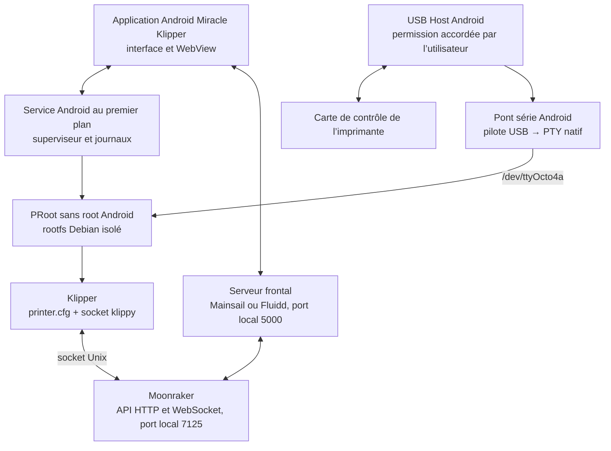

# Miracle Klipper — architecture cible (phase 1)

**Date :** 21 octobre 2026  
**État :** proposition prête à valider; les vérifications sur téléphone restent à faire.

## 1. Décision d’architecture proposée

Miracle Klipper reste une application Android sans dépendance au root Android. Android gère l’interface, les permissions USB et le cycle de vie du serveur. Klipper et Moonraker tournent dans un environnement Linux isolé sous PRoot. Le root visible dans cet environnement est simulé par PRoot et ne donne pas les privilèges root à Android.

Pour les composants serveur, la cible proposée est un **rootfs Debian 13 « trixie » ARM64 autonome**, stocké dans le répertoire privé de l’application. C’est la version stable de Debian à la date de ce document. Debian 12 « bookworm » reste un repli possible si les essais révèlent une incompatibilité de paquet sur l’appareil. Le bootstrap Octo4a existant reste une référence de lancement et de compatibilité; il ne sera pas utilisé comme environnement d’installation des services Klipper. [Versions Debian](https://www.debian.org/releases/)

Cette décision reste provisoire jusqu’à l’essai sur le téléphone. L’application télécharge les versions publiées par le constructeur amont, dont le README décrit un rootfs Alpine personnalisé; les scripts historiques utilisent `apk`. En revanche, le script local `bootstrap-builder/build_bootstrap.sh` tire ses paquets de Termux et construit des métadonnées `apt/dpkg`. Cette divergence doit être résolue avant de s’appuyer sur une compilation locale du bootstrap. Dans tous les cas, les scripts historiques ne seront pas repris tels quels dans Debian : les noms et versions de paquets, ainsi que les hypothèses de lancement, doivent être adaptés. Ils récupèrent aussi Klipper/Moonraker depuis des branches mouvantes ou des versions `latest`, donc ne sont pas reproductibles. Debian fournit un point de départ plus proche de la documentation actuelle de Moonraker. [Constructeur du bootstrap Octo4a](https://github.com/feelfreelinux/octo4a-bootstrap-builder), [Klipper — installation](https://www.klipper3d.org/Installation.html), [Moonraker — installation](https://moonraker.readthedocs.io/en/latest/installation/)

Le premier appareil visé est ARM64. Le support ARM 32 bits reste à confirmer en fonction du téléphone et de la disponibilité des dépendances natives.

## 2. Schéma



Le chemin série réutilise le mécanisme déjà présent dans Octo4a : `UsbManager` demande l’autorisation Android, le pilote USB communique avec la carte, puis le code natif expose un pseudo-terminal. Le bootstrap lie actuellement ce flux sous `/dev/ttyOcto4a`. Android permet à une application de découvrir le périphérique USB, de demander l’autorisation et de communiquer avec ses interfaces; le support OTG dépend aussi du matériel du téléphone. [Android — USB Host](https://developer.android.com/develop/connectivity/usb/host), [Android — modes USB](https://developer.android.com/develop/connectivity/usb)

## 3. Rôle et contrôle de chaque composant

| Composant | Contrat proposé | Vérification attendue |
| --- | --- | --- |
| Application Android | Configure l’instance, affiche les états réels, ouvre le frontal dans le WebView et présente les erreurs. L’identifiant de paquet `com.octo4a` est conservé pendant le pilote pour éviter de déplacer les données privées. | Démarrage/arrêt de l’application et affichage cohérent des états du serveur. |
| Superviseur Android | Démarre et arrête les processus PRoot, capture stdout/stderr, garde les codes de sortie, surveille la santé et redémarre uniquement selon une politique explicite. Remplace l’hypothèse qu’un script long constitue un gestionnaire de services. | Démarrages, arrêts, crash simulé, journaux conservés après fermeture de l’écran. |
| Gestionnaire Linux | Installe le rootfs et exécute des commandes avec arguments, répertoire et variables explicites. Les services sont lancés au premier plan; aucun `systemd` n’est requis dans PRoot. | Détection du rootfs, exécution de Python et d’un binaire natif, installation reproductible. |
| Klipper | Lit `printer.cfg`, pilote le MCU sur `/dev/ttyOcto4a` et expose son socket Unix dans `printer_data/comms`. | Démarre avec une configuration valide; état d’erreur explicite si le MCU est absent ou inaccessible. |
| Moonraker | Utilise le socket Klipper et expose l’API HTTP/WebSocket sur le port local 7125. L’accès réseau local reste désactivé par défaut; une exposition LAN devra exiger authentification et configuration dédiée. | Réponse à `server.info`, connexion WebSocket et absence d’accès non autorisé. |
| Frontal web | Mainsail et Fluidd sont deux choix interchangeables utilisant la même API Moonraker; un seul frontal est actif à la fois. Le serveur frontal sert les fichiers statiques sur le port local 5000 et relaie l’API/WebSocket. | Chargement du frontal, lecture d’état via Moonraker et connexion WebSocket. |
| Gestionnaire de configuration | Possède `printer.cfg`, `moonraker.conf`, journaux et sauvegardes. Toute écriture est validée et sauvegardée avant remplacement; import/export passe par le sélecteur de fichiers Android. | Import valide/invalide, sauvegarde, restauration et préservation après redémarrage. |
| Gestionnaire USB | Liste les périphériques, demande l’autorisation Android, choisit le pilote USB série, configure débit/format et publie un état distinct de celui des services. | Déconnexion/reconnexion, autorisation refusée/accordée, pilote inconnu et communication série. |
| KlipperScreen | Fonction optionnelle, hors pilote initial. Il dépend d’un backend graphique Linux (X11 ou Wayland); le WebView Android fournit le premier écran tactile. | À réévaluer après preuve d’un backend graphique exploitable sur ce téléphone. [Installation](https://klipperscreen.readthedocs.io/en/latest/Installation/), [backends](https://klipperscreen.readthedocs.io/en/latest/Backends/) |

Le frontal ne doit pas afficher « prêt » uniquement parce qu’un processus existe. Les états exposés sont séparés : `rootfs`, `Klipper`, `Moonraker`, `frontal`, `USB/MCU`; chacun a un statut, un dernier contrôle de santé et une erreur lisible.

## 4. Répertoires proposés

### Données privées Android

```text
<filesDir>/miracle/
├── rootfs/debian-trixie-arm64/       # Debian sous PRoot
├── shared/
│   ├── printer_data/
│   │   ├── config/printer.cfg
│   │   ├── config/moonraker.conf
│   │   ├── logs/
│   │   ├── gcodes/
│   │   └── comms/                    # socket Klipper
│   ├── backups/
│   ├── state/                        # manifeste d’installation et états durables
│   └── staging/                      # téléchargements temporaires vérifiés
└── web/
    ├── mainsail/
    └── fluidd/
```

Dans Debian, Klipper et Moonraker ont chacun leur dépôt et leur environnement Python (`venv`) séparés. `shared/` est lié dans PRoot sous `/var/lib/miracle`; le frontal sert un répertoire sous `/opt/miracle/web`. Les fichiers exécutables et les environnements Python ne sont pas placés sur le stockage externe partagé Android.

### Code Android proposé

```text
com.octo4a.server/       # superviseur, états et contrôles de santé
com.octo4a.linux/        # installation du rootfs et exécution PRoot
com.octo4a.config/       # configuration, validation, sauvegarde/restauration
com.octo4a.usb/          # détection, permissions Android et pont série
com.octo4a.frontend/     # sélection et accès au frontal web
```

Cette structure est une cible de conception; la phase 1 ne déplace pas encore les classes Kotlin existantes.

## 5. Ordre de démarrage et communication

1. Le service Android vérifie le manifeste, l’espace libre et l’intégrité du rootfs.
2. Le gestionnaire USB restaure le choix VID/PID de l’imprimante et demande à nouveau l’autorisation si Android l’a révoquée.
3. Le pont PTY est créé avant le lancement de Klipper. Si aucune imprimante n’est connectée, Klipper et la liaison MCU sont affichés comme indisponibles; Moonraker peut rester actif pour le diagnostic.
4. Klipper utilise `printer.cfg` et écrit son socket dans `printer_data/comms/klippy.sock`.
5. Moonraker se connecte au socket Klipper et effectue son contrôle de santé.
6. Le frontal choisi est servi localement et se connecte à Moonraker via HTTP/WebSocket.
7. À l’arrêt, le frontal et Moonraker sont arrêtés avant Klipper, puis le superviseur libère le pont USB.

Les commandes sont fournies au lanceur comme programme, arguments, environnement et répertoire courant; les chemins utilisateurs ne sont pas interpolés dans une commande shell. Les journaux sont séparés par composant. Les révisions Klipper, Moonraker et les archives web sont épinglées dans un manifeste avec somme de contrôle; aucune dépendance n’est installée depuis une branche `master` ou un alias `latest` au moment de l’exécution.

## 6. Stratégie de compatibilité et critères d’essai

| Domaine | Ce que l’inspection confirme | Essai qui reste requis sur appareil |
| --- | --- | --- |
| Gestionnaire de paquets | Le constructeur amont annonce Alpine et les scripts utilisent `apk`, mais le script local `bootstrap-builder/build_bootstrap.sh` produit un arbre Termux `apt/dpkg`. Ne pas confondre ces environnements. Le nouveau rootfs Debian utilisera `apt`. Les scripts historiques suivent aussi `master`/`latest` et ne sont pas reproductibles. | Démarrer un rootfs Debian 13 ARM64 dans PRoot et confirmer `apt`, Python, `venv` et les dépendances natives; adapter les paquets et épingler les sources. |
| Klipper/Moonraker | Les deux sont des services Python; Moonraker documente un environnement Debian et recommande Python maintenu. | Installer depuis des révisions épinglées, lancer les deux sans `systemd` et tester le socket/API. [Moonraker](https://moonraker.readthedocs.io/en/latest/installation/) |
| USB série sans root Android | Le code Octo4a utilise `UsbManager`, des pilotes USB série et un PTY natif lié à `/dev/ttyOcto4a`. La documentation Android confirme le modèle permission utilisateur. | Vérifier sur le modèle réel l’alimentation OTG, la permission, le débit et l’échange aller-retour avec la carte. |
| Bibliothèques natives | Le projet construit déjà ses bibliothèques pour ARM64, ARMv7, x86 et x86_64. | Vérifier les wheels Python et modules natifs Debian sur l’architecture effective du téléphone; ARM64 est la cible initiale. |
| Mainsail / Fluidd | Ce sont des frontaux web connectés à Moonraker; le bootstrap actuel les sert via nginx dans son script existant. | Servir les deux versions depuis le frontal local et vérifier API, WebSocket et comportement WebView. |
| KlipperScreen | L’installation amont suppose un environnement graphique Linux et un backend X11/Wayland. | Pas d’installation dans le pilote sans validation d’un backend graphique sur Android. |
| Rootless / arrière-plan Android | PRoot exécute les services sous l’UID de l’application; cela ne donne pas les privilèges Linux du noyau. | Vérifier service au premier plan, veille, reprise et arrêt sur la version Android du téléphone. |

La compilation debug de référence a réussi sur PC avec les quatre ABI Android. `adb devices -l` n’a toutefois détecté aucun téléphone : le pont USB, la compatibilité du rootfs et le cycle de vie Android ne sont donc pas encore validés matériellement. L’APK de compilation n’est pas une preuve de fonctionnement Klipper.

## 7. Décisions à confirmer avant la phase 2

- Valider le principe d’un rootfs Debian ARM64 isolé sous PRoot, avec les services supervisés par Android.
- Confirmer que KlipperScreen peut être différé; l’écran du téléphone utilisera d’abord le frontal Mainsail/Fluidd dans le WebView.
- Fournir le modèle du téléphone, sa version Android et le modèle de la carte de l’imprimante afin de compléter les essais rootless USB/PRoot.
- Le choix Mainsail ou Fluidd pourra rester un réglage utilisateur; le contrat Moonraker reste identique.

**La phase 1 reste en attente de validation** tant que le rootfs et la liaison USB n’ont pas été vérifiés sur le téléphone cible. La phase 2 ne commence pas avant cette validation, conformément au plan.
